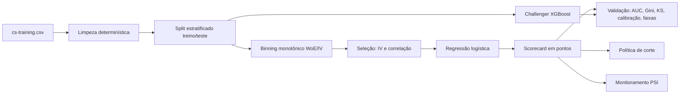

# Credit Scoring: scorecard WoE/IV + challenger XGBoost + monitoramento (PSI)

 

> **EN summary.** End-to-end credit-risk project on the *Give Me Some Credit* dataset: monotonic WoE/IV binning, a logistic-regression **scorecard** converted to points (600 pts = 50:1 odds, PDO 20), an **XGBoost challenger**, bank-style validation (AUC, Gini, KS, calibration, score bands), **PSI drift monitoring**, and an illustrative **cutoff policy** simulation. Fully tested (pytest + CI), reproducible with one command.

## Problema de negócio

Em crédito, a pergunta central é: **quem aprovar, a qual risco e com qual política de corte?** Um modelo de PD (probabilidade de inadimplência) só é útil se for **discriminante** (separa bons e maus), **calibrado** (a PD faz sentido), **explicável** (cada decisão pode ser justificada) e **monitorado** (ninguém percebe quando o modelo envelhece sem métricas de estabilidade).

Este projeto reproduz esse ciclo: modelar, validar, transformar em score, definir corte e monitorar.

## Dados

*Give Me Some Credit* (Kaggle), com cerca de 150 mil tomadores e alvo `SeriousDlqin2yrs` (atraso de 90+ dias em 2 anos). Como baixar: [`data/README.md`](data/README.md). Os dados não são redistribuídos aqui.

## Abordagem



Principais decisões (e por quê):

- **WoE com faixas monotônicas.** A taxa de maus deve evoluir de forma coerente com o negócio (mais utilização do limite, mais risco). Faixas pequenas são fundidas e valores ausentes ganham faixa própria.
- **Seleção por IV e correlação**, não por tentativa e erro; as variáveis descartadas e o motivo ficam registrados em `reports/results.md`.
- **Regressão logística como modelo principal.** É o padrão em risco porque cada variável vira pontos auditáveis; o XGBoost entra como *challenger* para medir quanto de poder preditivo o scorecard deixa na mesa.
- **Sem SMOTE nem pesos de classe.** Mantém as probabilidades próximas das taxas reais, o que importa para precificação e política de corte.
- **Limpeza sem estatísticas aprendidas** (idade < 18 removida; códigos 96/98 viram ausente), o que evita vazamento de dados.
- **Escala do score:** 600 pontos = odds 50:1 (bons:maus) e a cada 20 pontos as odds dobram (PDO = 20).

## Como rodar

```bash
git clone https://github.com/AndreMarques2002/credit-scoring-scorecard.git
cd credit-scoring-scorecard
make install                # instala dependências e o pacote
# baixe o cs-training.csv em data/raw/ (veja data/README.md)
make train                  # treina, valida e gera reports/ e models/
make test                   # roda os testes
make monitor                # PSI de uma nova base contra a referência do treino
```

Sem os dados, `make demo` roda o pipeline com dados **sintéticos** (só para demonstração; não use esses números).

## Resultados

> **PREENCHER:** rode `make train` com os dados reais e cole aqui o conteúdo de `reports/results.md`
> (desempenho, faixas de score, PSI, política de corte). Depois, referencie os gráficos abaixo.

Gráficos gerados em `reports/figures/`:

| | |
|---|---|
|  |  |
|  |  |

A tabela de pontos por faixa está em `reports/scorecard_points.csv`; as faixas e o IV de cada variável estão em `reports/iv_table.csv`.

## Estrutura

```
src/credit_scoring/
  woe.py          binning monotônico, WoE e IV
  scorecard.py    seleção de variáveis, logística e conversão em pontos
  challenger.py   XGBoost com early stopping e importância (contribuições nativas)
  metrics.py      AUC, Gini, KS, PR-AUC, Brier, tabela por faixas
  psi.py          PSI do score e das variáveis
  business.py     simulação de corte por lucro esperado
  train.py        pipeline completo (CLI)
  monitor.py      monitoramento de drift (CLI)
tests/            WoE, PSI, métricas e pipeline ponta a ponta
MODEL_CARD.md     finalidade, limites e governança do modelo
```

## Monitoramento

`python -m credit_scoring.monitor --data nova_base.csv` calcula o PSI do score e de cada variável contra a referência do treino. Regra prática: **< 0,10** estável, **0,10–0,25** atenção, **> 0,25** ação (investigar e reavaliar o modelo).

## Limitações e próximos passos

- O dataset **não tem data**, então a validação é aleatória (estratificada), não *out-of-time*. Em produção, a validação temporal é obrigatória.
- Há **viés de seleção**: só se observa o desempenho de quem foi aprovado no passado. Técnicas de *reject inference* tratariam isso.
- Os parâmetros de lucro e perda em `config.BusinessAssumptions` são **ilustrativos**.
- Não há análise de **equidade** por grupos nem avaliação de impacto regulatório. Ver `MODEL_CARD.md`.
- Próximos passos: validação temporal, monotonic constraints no XGBoost, calibração (Platt/isotônica) e *dashboard* de monitoramento.

## Licença

MIT. O dataset segue os termos da competição no Kaggle.
